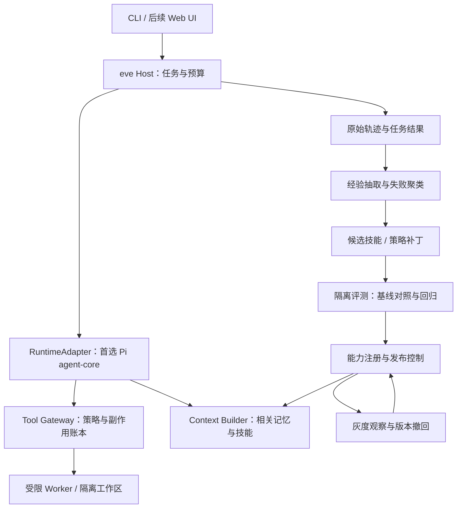

# eve：基于 DeepSeek Harness 与 Pi 调研的自我进化 Agent 技术方案

调研日期：2026-11-12。本文是技术调研与拟议设计，不是已实现功能说明。

## 1. 结论与产品定位

**建议 eve 以 Pi 的轻量执行能力为起点，借鉴 DeepSeek Harness 的宿主策略、插件边界与执行检查点，自建“有证据的能力进化控制层”。首个产品聚焦开发者工作区中的重复任务。**

eve 的卖点应表述为：**同类任务做得越多，能复用的可靠技能越多；每次能力升级都有来源、测试、版本差异和撤回记录。**

不要把“自动改提示词”“记住聊天内容”“可以生成插件”直接等同于能力提升。建议采用可检验定义：在固定任务分布、权限和模型配置下，新能力版本提高任务成功率，或在成功率不下降时降低成本/耗时，并通过回归约束。

第一阶段的进化载体是技能、工具组合、检索策略与局部任务策略。模型权重训练、无限自修改、自动提升权限和在线任意替换运行核心不进入 MVP。

### 1.1 选型假设

- 首期面向单用户、本地开发者工作区，任务以文件处理、代码修复、测试、资料整理为主。
- 以 TypeScript/Node.js 为主，CLI 优先；后续再加 Web/桌面界面。
- 使用外部模型 API，不预设必须使用 DeepSeek 模型，也不把模型品牌与 harness 绑定。
- 当前工作区未发现已有项目清单或 Markdown 文档；本方案按绿地项目设计。这不是对隐藏文件和全部目录的穷尽审计。
- 若实际目标改为直接竞争完整桌面助手，或首日就要求跨设备长任务恢复，需重新权衡 DeepSeek Harness 和 Pi durable 的复用比例。

## 2. 调研对象与证据边界

### 2.1 DeepSeek Harness

官方入口：[产品页](https://www.deepseek.com/en/harness/)；官方仓库：[deepseek-ai/deepseek-harness](https://github.com/deepseek-ai/deepseek-harness)。

本次固定源码提交：`e8f7b93a344964de3dca1ace9e72b6e4d6de87cb`，提交时间 2026-11-11 02:49:46 UTC。根包版本 `0.2.2-rc.2`；调研时发布记录首项为 `dsh-v0.2.2-rc.2`，发布标签对应另一提交，不能混作相同源码快照。许可证 MIT，第三方依赖另行核对。README 标注 developer preview。

其核心是 Cordis 驱动的插件化宿主：Agent 公共接口、默认 Agent loop、工具系统、会话日志、上下文、模型、沙箱、界面分别组合。产品提供 Web、headless、SDK、ACP 等装配方式。

### 2.2 Pi

本文中的 Pi 是 Mario Zechner 创建的开源 Agent 项目，原 `badlogic/pi-mono` 入口在调研时重定向到 [earendil-works/pi](https://github.com/earendil-works/pi)，不是 Inflection 的聊天产品。

本次固定源码提交：`b9c590049ec23ea0079a443801d42aa642931580`，提交时间 2026-11-12 13:55:20 UTC。该时间是研究进行中取得的版本时间，晚于用户最初发送请求的时间。许可证 MIT。本次读取的是主分支快照，不代表稳定发行版；命名空间与旧教程已有变化。

Pi 应按层理解：

| 层 | 职责 | eve 是否直接获得 |
|---|---|---|
| `pi-ai` | 模型 provider、消息、流式输出、工具调用协议、用量 | 获得模型接入；不因此获得 Agent loop |
| `pi-agent-core`（`packages/agent`） | Agent 状态、工具循环、输入队列、事件、取消 | 适合轻量运行时适配 |
| `pi-coding-agent` | CLI、AgentSession、工具装配、会话树、压缩、skills、extensions、SDK/RPC | 完整 coding worker 候选，需遵守其会话与信任语义 |
| `pi-durable`（实验性） | 持久任务、原子提交、恢复、会话、工具与自定义状态 | 应单独做故障验证，不能与 agent-core 混为同一能力 |

特别说明：DeepSeek Harness 已有 `packages/llm/llm-pi-ai` 适配。**它复用了 Pi 的模型访问层，不等于复用了 Pi 的 Agent loop、会话树或 durable runtime。**

### 2.3 研究方式与局限

本次读取了官方网页、固定提交的 README、设计文档及部分关键源码。未安装运行两个项目，未进行性能基准、故障注入、沙箱绕过或生成插件质量实验。下文的事实来自已引用资料，架构与阈值是为 eve 提出的设计建议。没有穷尽阅读全部源码，不能以“本次未发现”证明整个仓库绝不存在某功能。

## 3. 两个项目真正值得借鉴的部分

| 维度 | DeepSeek Harness：已核实事实 | Pi：已核实事实 | 对 eve 的意义 |
|---|---|---|---|
| 执行核心 | Agent 接口与默认 ReactLoopAgent 分离，turn/step 生命周期明确 | agent-core 提供轻量工具循环、事件及队列 | 保持可替换 RuntimeAdapter，不并行维护两套主循环 |
| 扩展 | Cordis 插件、技能、工具、界面组合，Creator 能生成扩展 | TS extensions、skills、prompts、packages；可让 Agent 创建扩展并 reload | 把能力产物版本化，但加载前另做质量控制 |
| 会话 | append-only Session 事件日志，派生模型历史 | coding-agent 维护会话 entry 树与活动叶子，支持分支 | 运行轨迹是证据；会话分支不代替隔离代码工作区 |
| 恢复 | checkpoint policy 在模型请求/顶层工具执行前 flush；未知工具结果显式标记 | coding-agent 提供会话持久化；另有实验性 pi-durable 提供持久任务 | 区分恢复上下文、恢复任务、恢复外部副作用 |
| 上下文 | 独立压缩 provider、结果裁剪、按模型窗口预算 | coding-agent 支持压缩摘要和分支摘要 | 原始证据独立存储，不靠摘要作为进化真值 |
| 输入干预 | inbox、下一步输入、取消 | steering 在当前 turn 及工具批次后注入；follow-up 在准备停止时取出 | steering 不等于立即抢占工具，取消要走宿主信号 |
| 工具调度 | bounded rolling pool；exclusive 调用形成屏障 | 默认并行，可全局/按工具串行 | 共享工作区写入和有依赖操作必须串行 |
| 权限 | 策略管道、monotonic guards、平台文件沙箱 | 项目信任门槛；扩展与 Pi 进程同权限 | 生成扩展不能直接进入高权限宿主 |
| 长期记忆 | 默认 shipped composition 不含 memory server，可接 MCP | 已核实的会话/资源能力不能当成自动经验学习 | 经验筛选、冲突、过期、删除由 eve 负责 |
| 进化闭环 | 已有生成/安装插件机制；未核实完整评测晋级闭环 | 已有生成/重载行为载体；已读 loop 未内置完整晋级协议 | eve 的主要独有工作在评价、发布、监测、撤回 |

### 3.1 DeepSeek Harness 的工程价值与限制

最值得借鉴的是三件事：

1. **副作用前记录意图。** 它明确承诺的是 durable execution intent，不是 exactly-once effects。进程崩溃后，某工具可能已完成外部写入而没记下结果，恢复时必须核验。
2. **普通扩展与宿主策略分开。** 工具前置策略之后还有 monotonic guards，可形成扩展难以放宽的拒绝边界。
3. **能力接口、provider、产品装配分层。** 不把模型、UI、插件管理和 loop 全揉在一起。

限制也影响选型：默认 loop 文档声明没有内置 turn budget；eve 要补时间、步骤和费用限制。文件沙箱不等于网络、凭据或 VM 隔离，`node:vm` 明确不是安全边界。插件变更可能影响同一 profile 的其他会话。安装流程的部分恢复不能被宣传为任意运行状态的一键回滚。

当前 base/SDK/headless 等组合与 Cordis 生命周期绑定。若仅需要简单单用户执行核心，整套引入的概念与适配成本偏高；若需要完整桌面产品与插件生态，这些成本可能值得承担。此处是设计判断，未做两套集成工时实测。

### 3.2 Pi 的工程价值与限制

Pi 适合 eve 的原因是执行层较容易嵌入和替换，模型层、Agent core、coding 应用的职责可分开使用。它把大量定制留给扩展，便于做实验。

需要防止三个误解：

- extension 能阻断工具，不代表 extension 本身处于权限沙箱；它运行于同一进程且有系统访问能力。
- session tree 的 branch 不会自动创建 Git worktree、隔离文件写入或撤回第三方 API 操作。
- RPC 的 prompt ACK 只说明接受请求。coding-agent 的 `agent_end` 后仍可能重试/继续，最终空闲应按该版本文档的 `agent_settled` 判断；这不自动推广到所有 Pi 包。

**补充核查：Pi 已有 `pi-durable`，不能笼统说 Pi 不支持可靠恢复。** 该包在本次提交明确标为 Experimental，基于 pi-ai 和 chord；README 描述 conversations、model turns、tool calls、自定义状态提交到存储后再对外展示，支持 SQLite/JSONL、持久任务状态机、`requestId` 提交去重与恢复。阶段在重启后可能从头执行，外部副作用仍需独立幂等。本文只补读其 README 前部与恢复示例，未完整审计工具恢复、存储后端或 API 稳定性，因此将其列为专门技术验证候选，不作为已验证生产依赖。

## 4. 架构决策：一个主循环，一层独立进化控制

### 4.1 推荐路线

**默认路线：TypeScript + Pi agent-core 适配器 + eve 自有工具网关、任务账本、能力注册表与进化控制。**

- `pi-ai` 处理模型协议，`pi-agent-core` 处理模型与工具循环。
- eve 决定工具权限、预算、版本选择、结果判定、任务恢复与能力晋级。
- 不把整套 coding-agent 与另一个自写 loop 叠在一起，避免两个上下文权威。
- coding-agent SDK/RPC 可作为独立 coding worker 备选；需要其会话树/压缩时再引入。
- pi-durable 的验证结果若好，可替换 RuntimeAdapter 和任务调度实现；上层能力注册、评测与发布协议保持不变。
- DeepSeek Harness 作为另一 RuntimeAdapter 的候选，不在 MVP 同时接入两套运行时。

### 4.2 备选路线与转向条件

| 路线 | 何时更合适 | 明确代价 |
|---|---|---|
| Pi agent-core + eve 控制层（推荐） | 小团队、单用户、强调进化机制实验与控制 | 工具网关、上下文压缩、有限任务恢复需自己实现 |
| Pi durable + eve 控制层 | 长任务恢复优先，且愿意锁定实验版并维护适配 | API 漂移；必须验证各类工具的崩溃恢复 |
| DeepSeek Harness + eve 插件/外部控制器 | 要快速复用完整应用、插件组合和检查点机制 | Cordis/版本耦合、profile 共享状态、需额外隔离与晋级层 |
| 深 fork 任一上游 | 有无法通过公开接口实现的硬需求 | 合并负担高；仅在明确阻塞后考虑 |

### 4.3 逻辑组件



组件边界：

| 模块 | 它拥有的权威状态 |
|---|---|
| Host/Scheduler | 任务状态、预算、取消、队列、运行绑定的能力版本 |
| RuntimeAdapter | 本次运行的模型/工具循环和流式事件，不决定晋级 |
| Tool Gateway | 规范化参数、权限决策、幂等键、执行意图和结果核验 |
| Trace Store | 原始事件、工具结果引用、模型/依赖版本、费用 |
| Memory Service | 有来源的事实与经验，支持删除、冲突与过期 |
| Evolution Controller | 候选生成、评测、晋级、撤回状态机 |
| Capability Registry | 不可变制品、哈希、依赖、版本、发布指针 |
| Eval Runner | 基线/候选的独立工作区、评测输入、评分与隔离 |

进化控制器不能改写预算上限、权限规则、隐藏测试和自己的发布门槛。这是宿主代码与运行环境强制执行的边界，不能只写进 prompt。

## 5. 将“自我进化”拆成可实现的闭环

### 5.1 进化层级

| 层级 | 改什么 | 自动化策略 |
|---|---|---|
| L0：记忆 | 用户偏好、项目事实、已确认约束 | 有来源、作用域、冲突/删除机制后可自动记录 |
| L1：技能 | 操作顺序、脚本、验证方法、适用条件 | MVP 主线；通过独立评测后可有限自动发布 |
| L2：任务策略 | 检索 top-k、工具选择、重试/上下文配方 | 每次只改少量变量，做成本与质量对照 |
| L3：工具/扩展代码 | 新工具、解析器、数据连接器 | 只在受限 worker 评测；涉及新增外部写权限需明确授权 |
| L4：运行核心 | scheduler、权限、记忆 schema、进化规则 | 后期走代码评审、迁移与发布；不在线自行改生产核心 |
| L5：模型权重 | SFT、偏好优化等 | 不进 MVP；需独立数据治理与训练成本论证 |

记忆增长与技能增长分开统计。用户说“以后报告用中文”是偏好学习；一次失败后提炼出稳定解决方法并跨任务验证，才算技能改进。

### 5.2 触发、归纳与候选生成

触发信号包括用户纠错、同类失败重复、工具重试偏多、成功但成本明显偏高。先按任务类型/错误原因聚类，避免每条聊天触发进化。

建议初始策略：同类问题累计至少 3 个有效轨迹再提出通用技能；单个清晰复现的 bug 可立即生成局部候选。这个数量是起步配置，不是研究证明的最佳值。

每个候选必须回答：失败发生在哪里？证据是什么？改动解决哪个机制？适用于哪些环境？何时应拒绝使用？怎样验证？是否增加工具或权限需求？

候选生成使用脱敏轨迹和可见开发集。测试维护进程持有隐藏集，候选 worker 无权读取。高预算候选排队且去重，避免“为进化而进化”。

### 5.3 状态机

```text
observed → proposed → built → evaluated → staged → active
                         └→ rejected         └→ revoked
```

- `observed`：轨迹已落盘，尚未形成改动。
- `proposed/built`：候选元数据与不可变制品已创建，不影响当前稳定能力。
- `evaluated`：保存完整评分、基线差异、环境与测试集哈希。
- `staged`：仅在新建的低风险任务中有限启用，运行中任务不热切换。
- `active`：注册表发布指针原子切换到新版本。
- `revoked`：禁止新任务使用该版本；进行中的任务按风险取消或收尾。

失败候选保留原因与已花预算，不进入检索可用列表。版本晋级必须使用比较并交换，确认父版本仍为当前基线，防止两个进化任务覆盖彼此。

### 5.4 具体例子

用户反复要求修复一个 Python 项目的测试。旧流程总在错误目录执行全量测试。eve 从轨迹中看到目录定位错误和重复高成本调用，生成一个“识别项目根目录→读取测试配置→运行相关测试→再跑规定回归”的技能。

这份技能先在多种目录结构、monorepo、多测试框架和缺失配置样本上验证；遇到无法确认的根目录应停止猜测。候选提高成功率或显著降低无效测试成本后，只对满足条件的新任务启用。若它在 monorepo 中选错包，系统撤回该版本并保存反例。

技能优化不得借由少跑必要回归来制造成本下降。最终任务完成标准和验证要求始终由任务契约决定。

## 6. 数据与接口设计

### 6.1 存储

初期用 SQLite（WAL）保存结构化状态，文件系统保存内容寻址制品，Git 保存可审查的技能和代码差异。FTS5 做关键词检索；先测检索效果，再决定是否加 embedding/向量库。单机 MVP 不需要微服务、Redis、Kafka 或独立向量数据库。

拟议表：

| 表 | 关键字段 |
|---|---|
| `tasks` | id, goal, acceptance_contract, status, deadline, budget, capability_snapshot |
| `runs` | id, task_id, model_config_hash, runtime_version, environment_hash, status, cost |
| `events` | run_id, seq, type, payload_ref, created_at；唯一键(run_id,seq) |
| `tool_calls` | call_id, idempotency_key, effect_class, intent, status, result_ref, reconciliation |
| `memories` | id, scope, kind, content_ref, source_event_ids, confidence, expires_at, supersedes |
| `capabilities` | id, version, parent_version, artifact_hash, applies_when, permissions, status |
| `eval_runs` | candidate_hash, baseline_hash, suite_hash, model_config_hash, seed, metrics, verdict |
| `releases` | scope, capability_id, active_version, previous_version, rollout, revision |
| `evolution_jobs` | cluster_id, state, candidate_id, spend, evidence_refs, rejection_reason |

原始事件以追加为主，隐私删除通过明确的删除/脱敏流程处理；不要把“不可变轨迹”解释为永远不能删除用户数据。能力内容不含明文凭据。

### 6.2 技能制品示例（eve 自定义 schema，不是 Pi API）

```yaml
id: python-targeted-test
version: 0.2.0
parent_version: 0.1.0
kind: skill
entrypoint: SKILL.md
applies_when:
  language: python
  task: test-repair
permissions:
  filesystem: workspace-write
  network: none
  secrets: []
artifact_hash: sha256:<由构建器填入>
evidence:
  source_runs: [run-101, run-108, run-119]
  eval_report: eval-42
  suite_hash: sha256:<由评测器填入>
activation:
  mode: staged
  fallback_version: 0.1.0
```

这些权限字段只有 Tool Gateway/worker 环境实际执行限制才有效。YAML 本身不提供隔离。示例 ID 为拟议数据，不对应真实评测结果。

### 6.3 RuntimeAdapter 的最小契约

- `start(task, contextSnapshot, toolGateway, budget)`：返回 run 标识与事件流。
- `steer(run, input)`：明确定义在安全边界注入，不承诺抢占正在执行的工具。
- `cancel(run)`：传播取消并确认已启动工具的最终状态。
- `status(run)`：区分排队、执行、等待核验、结束、失败。
- `resume(task)`：只有在恢复契约满足时可用；不能假装任意运行都能无损恢复。

Pi/DSH 事件先映射为 eve 的规范化事件。若使用 coding-agent SessionManager，则它作为会话上下文权威，eve 账本保存引用和业务事件，不独立双写一份可修改的聊天历史。

## 7. 评测：把卖点变成可测结果

### 7.1 评测集与数据泄漏控制

先做 3 类任务，每类约 20 个，共约 60 个有明确完成标准的样本。拆成可见开发集和隔离隐藏回归集；后续持续加入新失败样本，分组去重，避免同一仓库模板同时出现在两边造成虚高。

- 代码修复：相关测试及规定回归、修改范围、无新增缺陷。
- 文件处理：结构/数量/内容校验、边界输入、幂等性。
- 资料整理：来源支持度、引用可追溯、关键字段正确、无法确认时明确保留。

LLM judge 可辅助语义评分，不能独占正确性判定；优先使用测试、schema、文件内容与来源证据。judge 与候选生成角色分离，测试环境和评分规则由宿主持有。

### 7.2 基线对照

同时比较三组，避免把多轮尝试误当作学习收益：

1. 基础 Agent，无历史技能。
2. 相同模型和预算，只有检索记忆。
3. 相同模型和预算，使用 eve 已发布技能。

候选与当前稳定版本在同一批任务、模型参数、工具权限和依赖快照下成对比较。对于有随机性的任务，起步每个样本跑 3 次；结果接近时增加样本/次数，不能把小样本波动包装成确定提升。使用容器镜像/环境哈希控制环境差异，记录供应商模型别名漂移。

### 7.3 拟议晋级门槛

以下是可配置的初始产品政策，不是已测结果。评测 job 预先固定请求数和费用上限，耗尽即停止；证据不足不晋级。统计以独立任务为单位，重复运行在任务内聚合。按任务配对 bootstrap 10,000 次，固定种子，报告 95% 区间。质量门槛为成功率差点估计不小于 0，区间下界不低于 -2 个百分点，各预定义分组点估计退步不超过 5 个百分点。收益门槛为成功率差点估计至少 10 个百分点且下界大于 0；或单位成功成本下降点估计至少 20% 且成本比上界小于 1。单位成功成本为固定批次全部成本（含失败、重试、验证）除以成功数，零成功不得成本晋级。这是允许有限统计不确定性的建议政策；下列“不下降”按此非劣门槛解释，shadow 不能替代统计证据。

补充执行约束：隐藏集输入、逐题输出和详细报告不进入普通轨迹、记忆与候选生成上下文；生成器仅收有限聚合反馈，候选冻结后评测，同一候选谱系最多查询同一隐藏集 3 次。公开反例转开发集并退出隐藏判定集。撤回隔离坏版本产生且未独立确认的记忆，依赖候选重新评测；记忆记录来源运行与能力版本。运行不热换版本，紧急撤销可取消并阻止新工具派发。

推荐 agent-core 路线由 Context Service 统一构建模型上下文，负责预算、裁剪和压缩，摘要记录原始范围且不覆盖证据；工具全部经过 Gateway。任务边界恢复由 Host 核验副作用后重建已提交目标、能力快照和完成步骤，再创建新实例。非幂等本地写（追加、多文件部分修改、任意 shell）结果未知时不重放；幂等键持久绑定逻辑操作。结果制品耐久化后再提交 SQLite 引用，恢复检查缺失结果；故障测试分别强杀 worker 和 Host。

进化预算补充独立冷启动额度、过去 7 天开销的 10% 滚动额度和每日货币硬上限，配置后才开启自动付费进化，余额不足排队；分列生成、评测、shadow、维护及撤回费用，估算收支平衡复用次数。

具体约束：

- 权限边界、数据破坏、隐藏测试泄漏等关键断言零新增失败。
- 隐藏回归集按上述质量非劣与分组门槛判断，避免总体平均掩盖局部退步。
- 候选满足上述质量提升或成本下降门槛之一；证据不足时保持未发布，必要时扩充独立任务后重评。
- 成对成功率差使用配对统计/置信区间；候选很多时控制重复试验造成的选择偏差。不能反复查看同一隐藏集直到碰巧过关；隐藏集访问有预算并轮换。
- P95 延迟和总成本不突破任务允许值；成本包含失败重试。

首批约 60 题主要用于发现设计缺陷，不足以证明跨所有领域泛化。对外宣传只能使用实际评测覆盖的任务范围。

### 7.4 发布、观察与回滚

离线通过后先 shadow（副作用工具使用副本/模拟），再对匹配的低风险新任务小比例启用。起步可观察 20 个任务并至少覆盖 3 个子场景；任务量不足时继续 staged，不靠等待时间自动转正。

回滚改变未来任务使用的发布指针，不能自动撤销已经发送的消息、外部 API 写入、数据库变更等副作用。高风险行为需要独立补偿操作或人工核验。运行开始固定 capability snapshot，避免半途换技能导致不可复现。

## 8. 安全、恢复与成本是产品机制

### 8.1 权限与隔离

- 高权限 Host 负责策略和发布；生成的代码/扩展只在低权限 worker 运行。
- Git worktree 仅隔离代码版本，不是安全沙箱；评测使用受限容器/VM。macOS 上可通过容器 VM 提供 Linux 评测环境，实际网络限制要由运行环境执行。
- 默认只读挂载必要输入，仅开放工作输出目录；网络默认关闭或按目标域名开放；凭据由宿主代理按工具提供。
- 将 read-only、workspace-write、external-write 明确分级；外部写入是否允许取决于具体任务授权。
- retrieved 文档、网页和日志是数据，不得修改宿主规则。技能加载同样经过来源与权限审查。
- 共享文件写入设互斥或串行屏障。停止派发后等待在途工具，不能把取消回执当成所有副作用都已停止。

### 8.2 崩溃恢复

工具网关记录 `intent → started → completed/failed/unknown`，意图耐久写入后再启动执行。外部系统支持时传递幂等键。

恢复分类：

- 纯读取：在预算内重新执行。
- 幂等本地写：校验内容哈希或目标状态，再决定重试。
- 外部写入：查询远端状态或依赖幂等键；无法确认则标为 unknown 并停止自动重放。

最小故障验证点：记录意图前、记录意图后/执行前、执行后/结果提交前、提交后四个窗口强杀 worker。观察重复副作用数量、任务状态与证据是否一致，而不是只检查“恢复函数被调用”。

MVP 可以只支持任务边界恢复和明确的 unknown 处理，不承诺任意 token/工具中间点续跑。若完整恢复是首发要求，应优先验证 DSH checkpoint 或 pi-durable，避免手写通用 durable engine。

### 8.3 预算和投入回报

每次运行同时限制 wall-clock、模型请求数、工具调用数、token/费用和重试。模型可能不遵守“请停止”，预算必须由宿主拒绝新请求并取消工作。

进化默认只对高频或高损失任务触发，建议初始进化开销上限为近期任务模型开销的 10%，可按用户策略调整。至少记录：

`进化净收益 ≈ 预期复用次数 × 每次成功任务节省成本 − 候选生成、评测、维护成本`

这是调度启发式，不是财务预测。新能力要同时报告“带来多少额外成功”和“花了多少钱”，不能只统计技能数量。

## 9. 技术栈与建议目录

- Node.js：选择满足锁定版本依赖的受支持 LTS；DSH 当前要求 Node >=24.9.0，Pi 的实际 engine 另行核对后锁定。
- TypeScript、pnpm workspace；SQLite/WAL、内容寻址文件制品、Git。
- 模型：pi-ai adapter，至少保留两个 provider 的兼容验证；模型升级和技能升级分开评测。
- 检索：FTS5 起步，按测得的漏召回决定 embedding。
- 评测：容器/VM + 独立 workspace + 结构化结果；Vitest 等用于宿主关键状态机。
- 可观测：结构化事件和成本台账起步，必要时接 OpenTelemetry。

建议目录（本次只交付方案，未创建以下代码骨架）：

```text
eve/
  apps/cli/
  packages/host/
  packages/runtime-pi/
  packages/tool-gateway/
  packages/context/
  packages/memory/
  packages/evolution/
  packages/capability-registry/
  packages/eval-runner/
  capabilities/
  evals/dev/
  docs/
```

隐藏评测不存放在候选 worker 可挂载的项目目录中。`capabilities/` 存经审查的源文件，活动发布版本由注册表决定，而非“目录里存在就自动加载”。

## 10. 实施顺序与完成标准

以下是研发建议，不代表已开始实施，也不是工期承诺。按 1–2 名熟悉 TypeScript 的开发者估算，窄范围 MVP 约 6–8 周；隔离环境、数据集质量与恢复要求会显著影响时间。

| 顺序 | 交付 | 完成标准 |
|---|---|---|
| 1：验证底座，约 1 周 | 固定上游版本，Pi adapter、工具网关；用相同样例验证 pi-durable/DSH 恢复选择 | 可取消、可限额；写工具串行；崩溃结果 unknown 不重复外部写；形成明确选型记录 |
| 2：可靠单任务，约 1–2 周 | CLI、事件账本、上下文压缩、来源记忆、制品存储 | 3 类任务可执行，输出可独立验证；删除记忆有效；超额确实停止 |
| 3：技能闭环，约 2 周 | 失败聚类、候选生成、隔离评测、版本注册 | 一次真实失败可导出候选，在隐藏样本比较并据门槛接受/拒绝 |
| 4：灰度与撤回，约 1–2 周 | 运行绑定版本、shadow/staged、发布指针、故障测试 | 模拟回归时撤回，后续任务回到旧版；保留完整证据，进行中任务版本稳定 |
| 5：展示与优化，约 1 周 | 技能 diff、来源、成本/成功率对比、记忆/能力管理 | 用户能看懂“学了什么、为何启用、哪里变好、怎样撤回” |

最值得做的首个演示：同一类任务第一次失败 → 用户纠正 → eve 生成技能候选 → 在未见过的任务变体上评测 → 通过后启用 → 再次执行成功 → 注入一个反例 → 触发撤回。演示只使用可重置的本地副本，展示真实结果，不预填成功数字。

## 11. 最容易失败的设计与替代做法

| 失败设计 | 后果 | 替代 |
|---|---|---|
| 自评“我更好了”就更新生产 prompt | 无法验证、漂移、遗忘 | 独立验证器与固定基线 |
| 每个对话都自动产生 skill | 噪声、冲突、检索膨胀 | 按失败聚类、收益和预算触发 |
| 将外部文本当指令学习 | 注入、不可靠经验固化 | 来源分级、候选隔离、权限不升级 |
| 把所有历史放向量库 | 无关召回、隐私与陈旧事实 | 明确记忆类型、作用域、删除与失效 |
| 技能评测共用真实宿主凭据 | 误操作与污染 | 代理凭据、模拟/副本、受限 worker |
| 生成器可见全部隐藏评测 | 对测试集过拟合 | 分进程与访问控制，轮换评测 |
| 自动修改执行器与评测门槛 | 通过降低标准“进化” | 宿主策略不可由候选修改 |
| 同时采用两套主 Agent loop | 上下文、取消、恢复双重权威 | 单主运行时，统一 Adapter |
| 承诺回滚能撤销一切 | 外部副作用不可逆 | 区分版本撤回、结果核验与补偿 |

## 12. 来源与源码导航

下列固定链接支撑具体技术事实。上游持续变化，实施时应重新核对版本、包名和接口；本文不把主分支快照称作稳定 API。

### DeepSeek Harness

- [固定 README](https://github.com/deepseek-ai/deepseek-harness/blob/e8f7b93a344964de3dca1ace9e72b6e4d6de87cb/README.md)：身份、状态、入口。
- [架构](https://github.com/deepseek-ai/deepseek-harness/blob/e8f7b93a344964de3dca1ace9e72b6e4d6de87cb/docs/architecture.md)：Cordis、装配和部署边界。
- [Agent loop 源码](https://github.com/deepseek-ai/deepseek-harness/blob/e8f7b93a344964de3dca1ace9e72b6e4d6de87cb/packages/core/agent-loop/src/agent.ts)、[契约](https://github.com/deepseek-ai/deepseek-harness/blob/e8f7b93a344964de3dca1ace9e72b6e4d6de87cb/packages/core/agent-loop/README.md)。
- [工具管道](https://github.com/deepseek-ai/deepseek-harness/blob/e8f7b93a344964de3dca1ace9e72b6e4d6de87cb/packages/core/tools/src/pipeline.ts)、[批调度](https://github.com/deepseek-ai/deepseek-harness/blob/e8f7b93a344964de3dca1ace9e72b6e4d6de87cb/packages/core/tools/src/batch.ts)。
- [检查点实际实现](https://github.com/deepseek-ai/deepseek-harness/blob/e8f7b93a344964de3dca1ace9e72b6e4d6de87cb/packages/session/session-checkpoint-policy/src/index.ts)、[限制](https://github.com/deepseek-ai/deepseek-harness/blob/e8f7b93a344964de3dca1ace9e72b6e4d6de87cb/packages/session/session-checkpoint-policy/README.md)。
- [压缩](https://github.com/deepseek-ai/deepseek-harness/blob/e8f7b93a344964de3dca1ace9e72b6e4d6de87cb/packages/compaction/compaction-basic/README.md)、[JSONL 持久化](https://github.com/deepseek-ai/deepseek-harness/blob/e8f7b93a344964de3dca1ace9e72b6e4d6de87cb/packages/session/session-persistence-jsonl/README.md)。
- [沙箱边界](https://github.com/deepseek-ai/deepseek-harness/blob/e8f7b93a344964de3dca1ace9e72b6e4d6de87cb/docs/subsystems/sandbox.md)、[安全声明](https://github.com/deepseek-ai/deepseek-harness/blob/e8f7b93a344964de3dca1ace9e72b6e4d6de87cb/SAFETY.md)。
- [插件管理](https://github.com/deepseek-ai/deepseek-harness/blob/e8f7b93a344964de3dca1ace9e72b6e4d6de87cb/packages/boot/plugin-manager/README.md)、[动态 runner 边界](https://github.com/deepseek-ai/deepseek-harness/blob/e8f7b93a344964de3dca1ace9e72b6e4d6de87cb/packages/extensions/cordis-host-runner/README.md)、[Creator 技能](https://github.com/deepseek-ai/deepseek-harness/blob/e8f7b93a344964de3dca1ace9e72b6e4d6de87cb/packages/preset/agent-preset/README.md)。
- [默认无 memory server 的说明](https://github.com/deepseek-ai/deepseek-harness/blob/e8f7b93a344964de3dca1ace9e72b6e4d6de87cb/docs/user/guide/mcp-memory.md)、[pi-ai adapter](https://github.com/deepseek-ai/deepseek-harness/blob/e8f7b93a344964de3dca1ace9e72b6e4d6de87cb/packages/llm/llm-pi-ai/README.md)。
- [MIT](https://github.com/deepseek-ai/deepseek-harness/blob/e8f7b93a344964de3dca1ace9e72b6e4d6de87cb/LICENSE)、[第三方 notices](https://github.com/deepseek-ai/deepseek-harness/blob/e8f7b93a344964de3dca1ace9e72b6e4d6de87cb/THIRD_PARTY_NOTICES.md)。

### Pi

- [固定 README](https://github.com/earendil-works/pi/blob/b9c590049ec23ea0079a443801d42aa642931580/README.md)、[MIT](https://github.com/earendil-works/pi/blob/b9c590049ec23ea0079a443801d42aa642931580/LICENSE)。
- [模型层](https://github.com/earendil-works/pi/blob/b9c590049ec23ea0079a443801d42aa642931580/packages/ai/README.md)、[Agent core](https://github.com/earendil-works/pi/blob/b9c590049ec23ea0079a443801d42aa642931580/packages/agent/README.md)、[loop 源码](https://github.com/earendil-works/pi/blob/b9c590049ec23ea0079a443801d42aa642931580/packages/agent/src/agent-loop.ts)。
- [Coding Agent](https://github.com/earendil-works/pi/blob/b9c590049ec23ea0079a443801d42aa642931580/packages/coding-agent/README.md)、[工具装配](https://github.com/earendil-works/pi/blob/b9c590049ec23ea0079a443801d42aa642931580/packages/coding-agent/src/core/tools/index.ts)。
- [扩展与信任边界](https://github.com/earendil-works/pi/blob/b9c590049ec23ea0079a443801d42aa642931580/packages/coding-agent/docs/extensions.md)、[Skills](https://github.com/earendil-works/pi/blob/b9c590049ec23ea0079a443801d42aa642931580/packages/coding-agent/docs/skills.md)、[Packages](https://github.com/earendil-works/pi/blob/b9c590049ec23ea0079a443801d42aa642931580/packages/coding-agent/docs/packages.md)。
- [SDK/SessionManager](https://github.com/earendil-works/pi/blob/b9c590049ec23ea0079a443801d42aa642931580/packages/coding-agent/docs/sdk.md)、[RPC 完成语义](https://github.com/earendil-works/pi/blob/b9c590049ec23ea0079a443801d42aa642931580/packages/coding-agent/docs/rpc.md)、[压缩](https://github.com/earendil-works/pi/blob/b9c590049ec23ea0079a443801d42aa642931580/packages/coding-agent/docs/compaction.md)。
- [实验性 pi-durable](https://github.com/earendil-works/pi/blob/b9c590049ec23ea0079a443801d42aa642931580/packages/durable/README.md)：本文补充核实了 README 前部、概念、持久化与恢复示例，未完成整个子系统审计。
